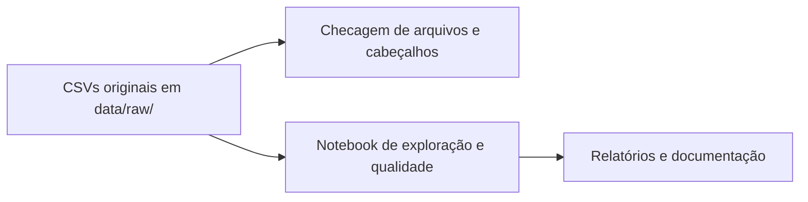

# Olist Analytics — E-commerce Performance & Customer Experience

Acompanhar o desempenho do e-commerce exige saber como os pedidos evoluem, com que frequência as entregas atrasam e como as notas variam nesses casos. A análise precisa considerar datas ausentes e as diferentes granularidades de pedidos, itens, pagamentos e avaliações.

Olist Analytics é um projeto de portfólio em Análise de Dados e BI cujo objetivo é construir uma base confiável para indicadores de desempenho comercial e experiência de compra. A etapa exploratória concluída documenta a cobertura dos dados, compara critérios de atraso e verifica o risco de duplicar valores em junções.

## Sumário

1. [Visão geral da análise](#1-visão-geral-da-análise)
2. [Principais descobertas](#2-principais-descobertas)
3. [Dashboard](#3-dashboard)
4. [Arquitetura e metodologia](#4-arquitetura-e-metodologia)
5. [Tecnologias](#5-tecnologias)
6. [Como configurar e executar](#6-como-configurar-e-executar)
7. [Status da implementação](#7-status-da-implementação)
8. [Documentação](#8-documentação)

## 1. Visão geral da análise

O recorte contém 99.441 pedidos com compras entre setembro de 2016 e outubro de 2018. Os nove arquivos reúnem pedidos, itens, pagamentos, avaliações, clientes, vendedores, produtos, geolocalização e tradução de categorias. [Dataset público da Olist no Kaggle](https://www.kaggle.com/datasets/olistbr/brazilian-ecommerce)

- **Desempenho comercial.** Como o volume de pedidos evoluiu no período e quais categorias concentram mais itens?
- **Entrega e experiência.** Qual é a frequência de atraso e como as notas variam entre entregas no prazo e atrasadas?
- **Confiabilidade dos indicadores.** Quais datas ausentes, diferenças de granularidade e lacunas de cobertura podem alterar a leitura dos resultados?

## 2. Principais descobertas

| Tema | Evidência da análise exploratória |
| --- | --- |
| Volume de pedidos | Novembro de 2017 teve o maior volume observado, com 7.544 pedidos. Os meses no fim da série têm poucos registros e exigem cautela na comparação. |
| Categorias | Cama, mesa e banho liderou em volume, com 11.115 dos 112.650 itens (9,87%). |
| Atraso | Entre 96.470 pedidos entregues com datas válidas, 6.534 chegaram após o dia previsto (6,77%). Pelo horário gravado, foram 7.826 atrasos (8,11%) no mesmo grupo. |
| Avaliações | Notas 1 ou 2 representaram 62,41% das 6.409 linhas de avaliação com nota ligadas a pedidos elegíveis atrasados e 9,28% das 89.944 ligadas a entregas elegíveis no prazo ou antes. A diferença descreve uma associação na amostra. |
| Granularidade | Em um teste, unir itens, pagamentos e avaliações diretamente por pedido inflou em 28,55% a soma dos pagamentos pela repetição de linhas. |

As evidências, limitações e perguntas para aprofundamento estão no [relatório de descobertas](reports/eda_findings.md).

## 3. Dashboard

**Planejado.** O protótipo será desenvolvido no Figma e o relatório no Power BI Desktop. A proposta é acompanhar o volume e o status dos pedidos, comparar categorias e regiões e explorar a relação entre pontualidade e notas. O modelo dimensional e as medidas DAX serão desenvolvidos nas próximas etapas.

## 4. Arquitetura e metodologia

O fluxo atual roda localmente, desde a leitura dos CSVs até a validação dos resultados documentados.



O Pandas faz o perfil das tabelas e examina nulos, duplicatas, chaves, distribuições e cobertura temporal. O notebook mede a correspondência nos dois sentidos entre as tabelas e usa SQL no DuckDB para conferir o efeito das junções. As comparações por status, prazo e avaliação têm denominadores explícitos. Os CSVs originais permanecem em `data/raw/`.

## 5. Tecnologias

| Tecnologia | Uso no projeto | Status |
| --- | --- | --- |
| Python 3.11+, Pandas, JupyterLab e Matplotlib | Leitura, análise exploratória e visualizações | Em uso |
| DuckDB e SQL | Consultas locais e conferência das junções | Em uso |
| Git e GitHub | Versionamento e revisão das entregas | Em uso |
| PyArrow e Parquet | Armazenamento local das saídas preparadas | Uso planejado |
| Figma | Prototipação visual do dashboard | Planejado |
| Power BI Desktop e DAX | Modelo semântico, indicadores e dashboard | Planejado |

## 6. Como configurar e executar

No PowerShell, a partir da raiz do projeto, prepare um ambiente virtual com Python 3.11 ou superior, instale as dependências de `requirements.txt` e extraia os nove CSVs em `data/raw/`. Em seguida, inicie o JupyterLab.

```powershell
.\.venv\Scripts\python.exe -m jupyterlab
```

Abra `notebooks/01_data_profiling.ipynb` e execute as células em ordem com o ambiente do projeto. Para os comandos de instalação e checagem dos CSVs, consulte o [guia de configuração e execução](docs/setup.md). Para executar a suíte automatizada, consulte o [guia de testes](tests/README.md).

## 7. Status da implementação

| Etapa | Status | Entrega |
| --- | --- | --- |
| 1. Estrutura e ambiente | Concluída | Dependências, diretórios, checagem dos CSVs e teste automatizado |
| 2. Exploração e qualidade | Concluída | Notebook executado, dicionário de dados, relacionamentos e relatórios |
| 3. Preparação e modelagem dimensional | Planejada | Regras de tratamento, saídas em Parquet e modelo dimensional |
| 4. Dashboard e comunicação dos resultados | Planejada | Protótipo no Figma, medidas DAX e relatório no Power BI |

## 8. Documentação

| Documento ou módulo | Conteúdo |
| --- | --- |
| [Guia de configuração e execução](docs/setup.md) | Ambiente Python, CSVs, notebook e testes no PowerShell |
| [Verificação dos arquivos](src/validation/check_raw_files.py) | Presença dos nove CSVs esperados |
| [Leitura dos cabeçalhos](src/ingestion/read_raw_headers.py) | Leitura com Pandas e listagem das colunas por arquivo |
| [Notebook de exploração](notebooks/01_data_profiling.ipynb) | Código, tabelas e gráficos da etapa exploratória |
| [Dicionário de dados](docs/data_dictionary.md) | Campos, tipos lógicos e significado das colunas |
| [Relacionamentos e granularidade](docs/source_relationships.md) | Chaves, cardinalidades, cobertura e riscos em junções |
| [Relatório de qualidade](reports/data_quality_report.md) | Ocorrências verificadas e alternativas de tratamento |
| [Relatório de descobertas](reports/eda_findings.md) | Perguntas de negócio, evidências, interpretações e limitações |
| [Guia de testes](tests/README.md) | Execução e inclusão de testes automatizados |

## Estrutura do repositório

```text
olist-analytics/
├── data/              # CSVs locais em raw/ e áreas reservadas em interim/ e processed/
├── notebooks/         # Notebook de exploração e qualidade
├── src/               # Checagens de entrada e áreas reservadas para limpeza e modelagem
├── sql/               # Área reservada para scripts SQL
├── tests/             # Teste automatizado e guia
├── docs/              # Configuração, dicionário e relacionamentos
│   └── figma/         # Área reservada para o protótipo
├── powerbi/           # Área reservada para o relatório
├── reports/           # Relatórios de qualidade e descobertas
├── .gitignore
├── requirements.txt
└── README.md
```
